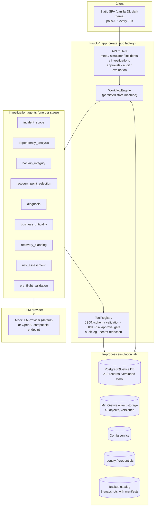

# Architecture

## System overview



## Workflow state machine

States are persisted on the `investigations` row (`current_state`); every change
is validated against a `TRANSITIONS` map and recorded in `stage_runs`.

```
DETECTED -> SCOPING -> DEPENDENCY_ANALYSIS -> BACKUP_INTEGRITY ->
RECOVERY_POINT_SELECTION -> DIAGNOSIS -> BUSINESS_CRITICALITY ->
RECOVERY_PLANNING -> RISK_ASSESSMENT -> PRE_FLIGHT_VALIDATION ->
AWAITING_APPROVAL -> APPROVED -> EXECUTING -> VERIFYING -> COMPLETED
                                                     \-> FAILED -> ROLLED_BACK

AWAITING_APPROVAL -> FAILED   (human rejects; outcome="rejected",
                               pending actions cancelled)
VERIFYING -> COMPLETED | FAILED  (post-restore verification verdict)
FAILED -> ROLLED_BACK            (restore pre-execution lab image)
```

Guards enforced by `backend/app/workflow/engine.py`:

- stage functions only run when the machine is in the expected prior state;
- duplicate stage execution raises (`StageRun` already recorded);
- `execute_and_verify` refuses anything not in `APPROVED`;
- rollback is only legal from `FAILED`.

## Agent pipeline (9 stages)

Each agent: pulls facts **only** via registered tools, writes typed
`evidence` rows, persists a `decision` (with confidence, alternatives
considered, risk level, approval requirement), and updates
`investigation.context` by full-dict reassignment (never in-place JSON mutation,
which SQLAlchemy change tracking would miss).

| Stage | Tool facts consumed | Decision produced |
|---|---|---|
| incident_scope | query_incident_timeline | affected asset set + blast radius |
| dependency_analysis | query_dependency_graph | ordering constraints |
| backup_integrity | query_backup_catalog | per-snapshot integrity verdicts |
| recovery_point_selection | query_backup_catalog + scoring | clean point BKP-k + rejected alternatives |
| diagnosis | detector stats | root cause hypotheses (3, ranked) |
| business_criticality | asset tiers | minimum viable business scope (tier <= 1) |
| recovery_planning | graph order + clean point | 10 ordered actions, RTO/RPO estimates |
| risk_assessment | weighted factors | 48/100 medium + rationale |
| pre_flight_validation | plan dry-run checks | executable / blocked |

## Recovery ordering

Kahn's topological sort over the typed dependency graph:

1. ready set = nodes whose dependencies (within scope) are all emitted;
2. pick the ready node with smallest `(tier, name)` - tier first for business
   priority, name as a deterministic tie-break;
3. one node per loop iteration keeps the output fully deterministic.

Result for the shipped topology:
`config-store, core-postgres, identity-service, object-storage, customer-service,
payment-service, order-service, web-frontend, reporting-service`.
`is_valid_execution_order` re-checks any executed sequence against the graph and
feeds the evaluation score.

## Clean-point selection

Candidates are scored deterministically (`app/agents/clean_point.py`):

- recency points `100 * (n - rank) / n`
- completeness bonus up to `20`
- RPO penalty `hours_older * 5`
- ineligible snapshots score `-1000 + violation_count`

Eligibility requires checksum match AND zero malicious indicators AND taken
before compromise start. The naive-latest check explicitly compares the chosen
point to BKP-008 so the "latest is not clean" property is asserted, not assumed.

## Backup integrity model

Each snapshot stores a manifest (counts + sample entries) and a sha256 checksum
computed over the canonical manifest JSON. Hidden malicious markers are sample
entries (`encrypted_record_marker`, `encrypted_object_version`). In the
`corrupted_latest` scenario BKP-008's checksum is computed **before** a post-hoc
manifest tamper (+999 encrypted markers, tampered flag), so recomputation
mismatches exactly like real post-hoc tampering would.

## Simulation lab

`app/lab/state.py` seeds deterministic data via `uuid5` chains (same run ->
same IDs): 10 assets, 17 typed dependencies across 5 edge types, 210 DB records
across 4 tables, 48 storage objects, 18 config keys, 6 credential principals
(3 compromised at injection), 8 hourly snapshots (BKP-001..BKP-008). Fault
injection flips flags rather than deleting history so pre/post state is always
recoverable; execution captures a serialized pre-state image before the first
action to power rollback.

The business probe (`app/lab/business_txn.py`) runs a live 7-step transaction
(authenticate -> load config -> browse -> cart -> checkout -> order created) and
persists the submitted order; its dry-run projection is used in pre-flight
validation.

## Data model

22 SQL tables (SQLAlchemy 2.x DeclarativeBase): assets, dependencies,
db_records, storage_objects, config_entries, credentials, backup_snapshots,
events, incidents, investigations, stage_runs, evidence, hypotheses, decisions,
risk_assessments, approvals, actions, outcomes, validations, metric_snapshots,
evaluation_runs, tool_calls. Naive UTC datetimes everywhere (SQLite round-trip
safety). Schema is created with `Base.metadata.create_all` at startup.

## Observability

Prometheus counters/histograms/gauges (`cro_*` names) exposed at `/metrics`:
tool calls, stage durations, workflow duration, LLM latency/retries, approvals,
recovery results, plus RTO/RPO/clean-point-accuracy/ordering-correctness gauges.
A JSON convenience view sits at `/api/v1/metrics/summary`; outcomes also persist
`metric_snapshots` rows so results survive process restarts.
